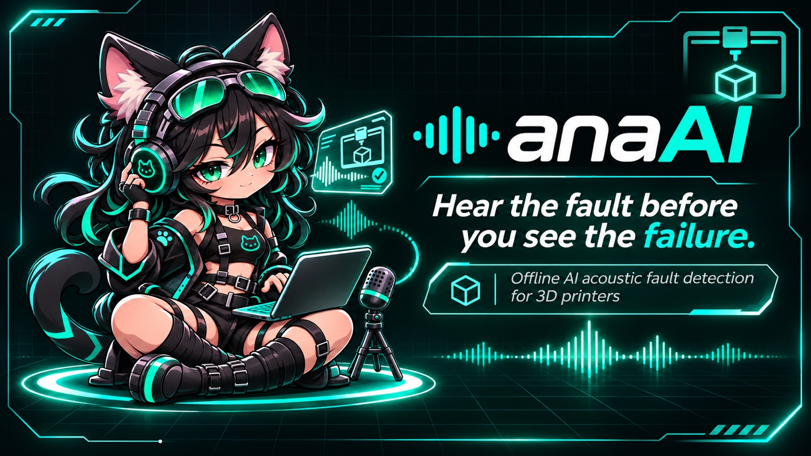

<div align="center">



# anaAI

### Hear the fault before you see the failure.

**Offline acoustic fault detection for desktop FDM printers.**

[](#project-status)
[](#hardware-direction)
[](#how-it-works)
[](#roadmap)
[](LICENSE)

**Listen locally. Detect early. Keep printing.**

</div>

---

## Project status

> [!IMPORTANT]
> **Project status:** concept and repository foundation. There is no trained model, validated fault detector, tested firmware, or shipping hardware yet. The badges above describe intent and status, not test results.

## Meet the mascot

<div align="center">
  <a href="assets/anaai-avatar.png"></a>
  &nbsp;&nbsp;
  <a href="assets/anaai-mascot-plaque.png"></a>
</div>

Approved Baseline 2 artwork is preserved in [the brand kit](docs/BRANDING.md). The source artwork and logo remain subject to their separate branding rights.

## Why anaAI?

Printers already have sensors for temperatures, position, and sometimes filament presence. But many mechanical failures announce themselves audibly before a conventional sensor notices: an extruder clicking under load, a nozzle scraping across a print, or a fan beginning to rattle.

**anaAI** explores whether a small, self-contained listener can distinguish those sounds from ordinary printing and provide a useful warning without sending audio to a cloud service.

The name preserves the project's original inspiration in *active noise attenuation*. Its scope is now **acoustic analysis**, not active vibration cancellation.

## The first problem

**Detect extruder skipping in a noisy, operating printer.** Everything else comes later.

| Stage | Intended behavior | Not yet claimed |
| :-- | :-- | :-- |
| Baseline | Collect reproducible normal and skipping audio | Dataset not recorded |
| DSP comparator | Detect suspicious clicks with conventional processing | Performance unknown |
| TinyML | Classify acoustic features locally | No model trained |
| Validation | Measure precision, recall, false alarms, and latency on held-out sessions | No results yet |
| Alert | Signal a suspected fault without controlling the printer | No physical integration yet |

The learned model must demonstrate incremental value against a simple spectral or transient detector. If it cannot, we report that plainly rather than stapling a neural network onto a solved problem.

## How it works

```text
printer sounds
      |
[I²S MEMS microphone]
      |
[buffer + preprocessing] ----> [conventional DSP baseline]
      |
[small on-device ML model]
      |
[confidence + temporal debounce]
      |
[local alert / logged event]

No cloud dependency. No printer control in the first prototype.
```

The architecture is provisional. Sampling, model selection, decision thresholds, and fault signatures are subject to measurements.

## Hardware direction

An **ESP32-S3** with an **I²S MEMS microphone**, locally powered and mounted reversibly outside the print path. The initial prototype is alert-only, with a manual reset and a visible indication of uncertain classifications.

No custom PCB, permanent modification, or printer-firmware dependency is required for the first experiment. These are design goals, not verified specifications.

## Roadmap

| Milestone | Exit criterion |
| :-- | :-- |
| **M0 · Foundation** | Project scope, documentation, issue triage, repeatable evaluation contract |
| **M1 · Acoustic Evidence** | Labeled recordings of normal printing and verified extruder skipping, including background conditions |
| **M2 · Classical Baseline** | Reproducible classical DSP comparator, held-out evaluation protocol |
| **M3 · Embedded Intelligence** | Quantized model runs on target and demonstrates a defensible benefit |
| **M4 · Prototype** | Integrated, alert-only hardware demonstrates bounded, repeatable detection |

Milestone names describe planned work, not completed achievements. See [Issues](https://github.com/thetechbenders/anaAI/issues) for the active backlog.

## What success means

A demonstration counts only if the detector is evaluated on **held-out printing sessions** and compared fairly with conventional DSP. We will track:

- False alerts per hour of normal printing.
- Recall and precision on **verified** extruder-skip events.
- Detection latency from an independently marked event.
- Performance across changes in fan speed, motion, material, and microphone placement.
- Power, memory use, and inference latency on actual target hardware.

No numbers will be advertised before they're measured.

## Non-goals for v0.1

Automatic pause commands, cloud inference, voice assistants, multi-printer fleet management, nozzle-scrape classification, proprietary printer integrations, new custom PCBs, and diagnosis of every possible mechanical problem.

## Working on anaAI

- Start with the [issue tracker](https://github.com/thetechbenders/anaAI/issues) and choose a small measurable slice.
- Keep raw acoustic recordings and potentially identifying background speech out of Git history. Use a documented consent and data-retention policy.
- Prefer reversible hardware setups and explicit operator control.
- Distinguish simulations, host tests, embedded builds, and actual printer trials.
- Never claim safety or accuracy from synthetic-only evaluation.

See [CONTRIBUTING.md](CONTRIBUTING.md) for contribution guidance, [SECURITY.md](SECURITY.md) for sensitive reporting and responsible testing, and [the architecture sketch](docs/ARCHITECTURE.md) for the proposed design.

## License

Software and project documentation are licensed under the **GNU Affero General Public License v3.0 only (AGPL-3.0-only)**. See [LICENSE](LICENSE). This choice does **not** grant a separate license to the project's mascots, logos, illustrations, or future acoustic datasets. See [the license scope note](LICENSE-DECISION.md) and [brand kit](docs/BRANDING.md).

The initial project foundation is intentionally lean. Contribution guidance and automation will grow alongside real code rather than manufacturing green badges.

---

<div align="center">

**A small ear for a loud machine.**

Built under [Techbenders](https://github.com/thetechbenders) · Research-stage project

</div>
